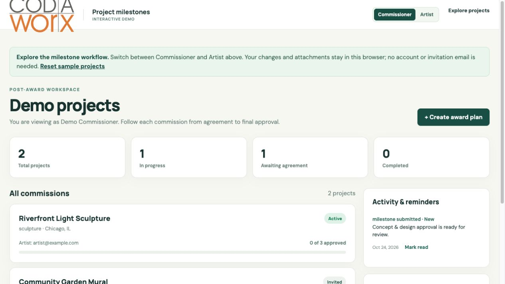
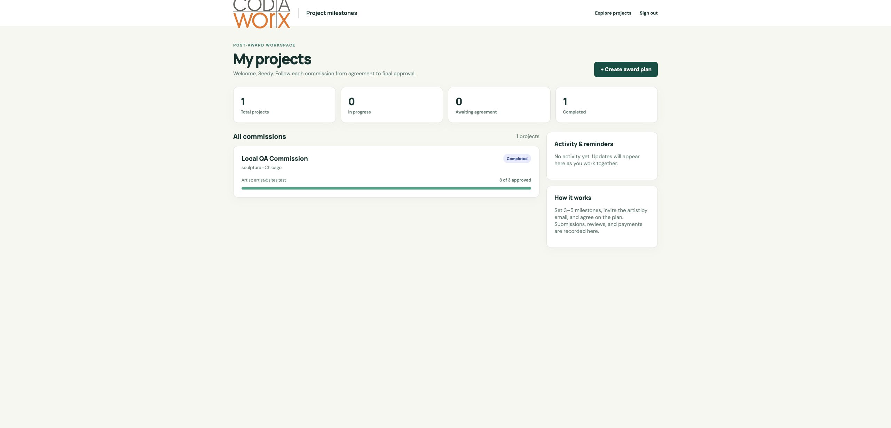
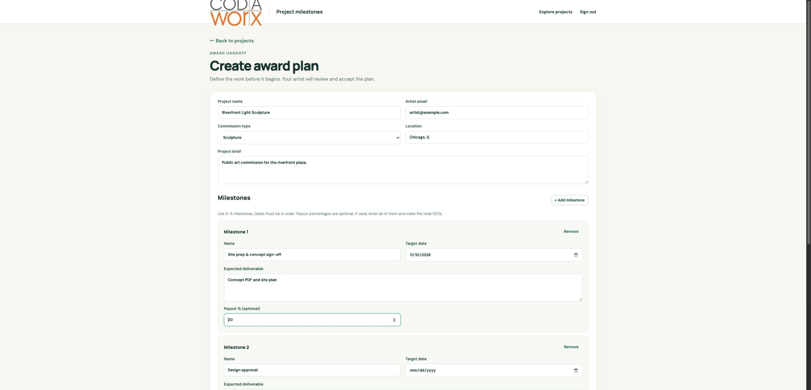
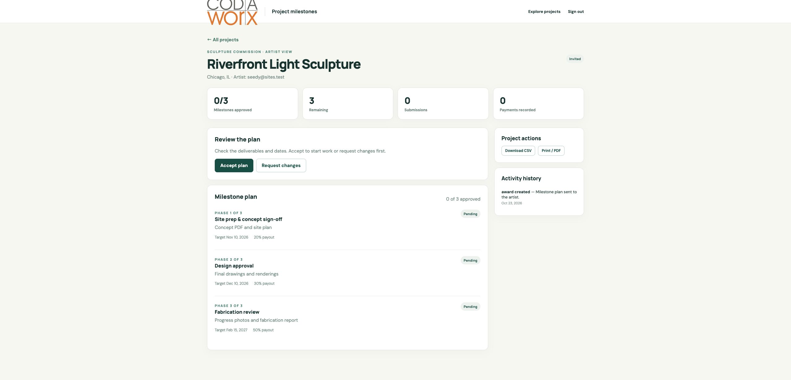
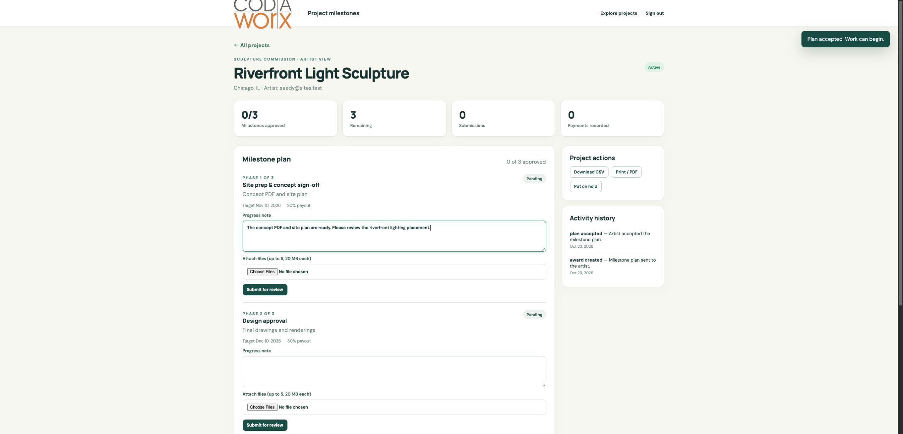
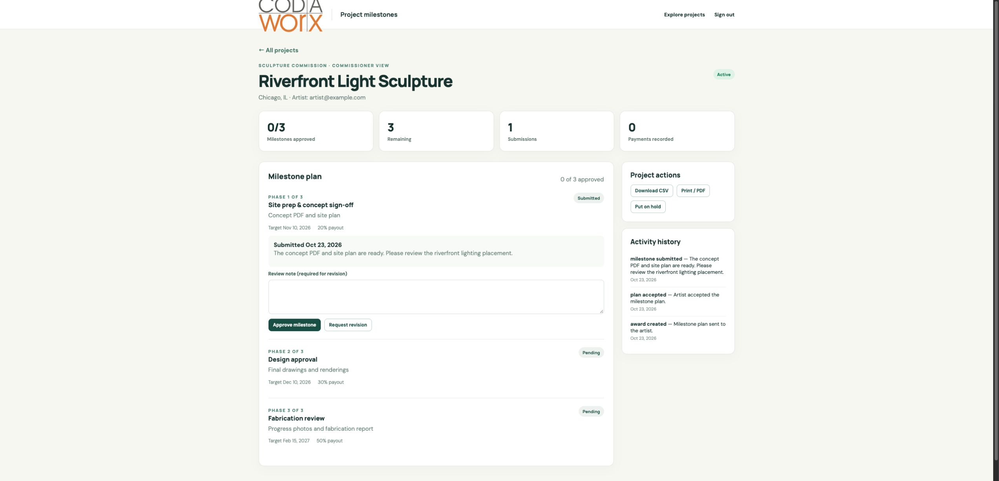
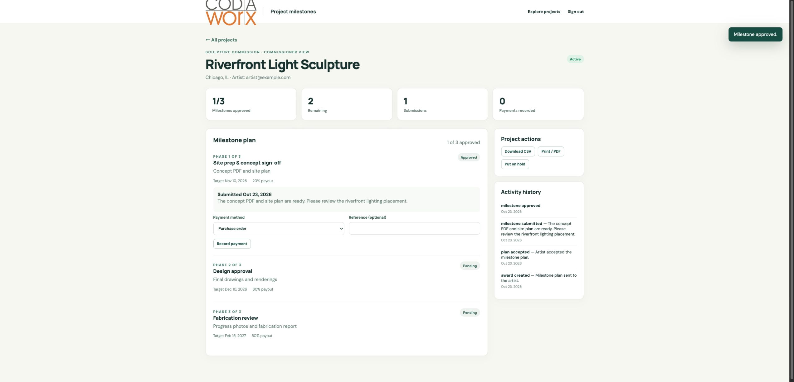

# Milestone tracker walkthrough

[Open the live demo](https://codaworx-gallery-remake-2026.fluffyrice14.chatgpt.site/tracker.html). It opens with sample projects and **does not require a login**. Switch between Commissioner and Artist at the top of the page. Changes stay in your browser.

## 1. See the sample projects

The dashboard starts with Riverfront Light Sculpture, ready for commissioner review, and Community Garden Mural, waiting for artist agreement. Choose a project to see its milestones and activity.

## 2. Set the plan as a commissioner

Choose **Create award plan**. Enter a project and artist email, then set 3–5 milestones. Each needs a name, deliverable, and target date. Optional payout percentages must total 100%. The email is demo data and does not send a message.

## 3. Review the plan as an artist

Switch to **Artist** and open the invited project. Choose **Accept plan** or **Request changes**. For a change request, switch back to Commissioner to revise the plan.

## 4. Submit and review progress

As Artist, enter a progress note and optionally attach up to five files. As Commissioner, approve the submission or request a revision. The files are saved only in your browser.

## 5. Track payment status

After approval, Commissioner can record a purchase order, check, or other payment method. This records a demo status; no money moves. CSV and **Print / PDF** are available in the project's actions. Once all milestones are approved, a project can be added to this browser's gallery.

Use **Reset sample projects** on the dashboard to start again. Browser storage can be cleared by your browser, so this demo is not a shared production workspace.
